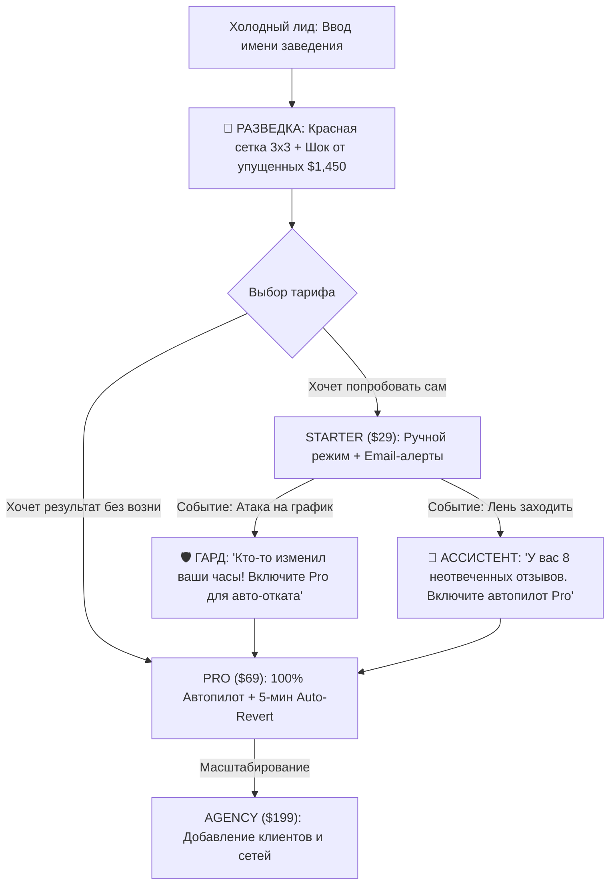

# 06. Monetization & Pricing Policy: The 3-Module Triad

## Executive Summary & Strategic Framework

GBPilot is an autonomous Google Business Profile (GBP) and local Generative Engine Optimization (GEO) SaaS. To eliminate cognitive overload, overcome dashboard fatigue, and provide crystal-clear value perception, the entire product is structured around **3 Global Pillars (The Operational Triad)**:

```
┌────────────────────────────────────────────────────────────────────────────────────────┐
│                              THE GBPILOT OPERATIONAL TRIAD                             │
├────────────────────────────┬────────────────────────────┬──────────────────────────────┤
│        🧭 РАЗВЕДКА         │        🤖 АССИСТЕНТ        │           🛡️ ГАРД            │
│       (SCOUT RADAR)        │      (ACTION COPILOT)      │       (DEFENSE SHIELD)       │
├────────────────────────────┼────────────────────────────┼──────────────────────────────┤
│     «Глаза & Стратег»      │        «Руки & Труд»       │        «Щит & Охрана»        │
│ Диагностика, Geo-Grid      │ Генерация постов, LSI-     │ Контрразведка, защита        │
│ тепловые карты, радар      │ ответы на отзывы, график,  │ от атак конкурентов,         │
│ конкурентов, GEO / LLM SOV │ атрибуты, 1-Click мутации  │ 5-минутный авто-откат правок │
└────────────────────────────┴────────────────────────────┴──────────────────────────────┘
```

### The Packaging Philosophy: Dubai GTM & Depth of Automation
To conquer the competitive Dubai and UAE hospitality/retail market with frictionless adoption, **entry barrier is lowered to 39 AED/mo (~$11/mo)**.
The product is divided into **3 Global Pillars**:
1. **Мониторинг (Monitoring & Radar):** 24/7 rank tracking, 360° Data Matrix, competitor category gaps, threat detection.
2. **Постинг (Posting & Social Sync):** Automated Google Business Profile local updates + **seamless Instagram & TikTok auto-repurposing** via Gemini AI.
3. **Защита (Defense Shield & Auto-Rollback):** Sentinel 24/7 auto-rollback of competitor edits (phone, hours, status) within 5 minutes.

### Tier Structure:
* **Base Monitor (39 AED / $11/mo):** 1 Location. Full monitoring + Threat alerts (Notification without auto-fix; prompts upgrade).
* **Growth & Social Repurposer (69 AED / $19/mo):** Up to 2 Locations. Full monitoring + Active GBP Posting + **Seamless Instagram & TikTok auto-reposting** to Google Maps + Threat alerts with 1-click auto-fix upgrade.
* **Shield Sentinel / Max Plan (99 AED / $27/mo):** Up to **5 Locations**! Everything in Growth + **Full 24/7 Sentinel Auto-Rollback Shield** + Autonomous AI Review Replier + Priority 300 QPM sync.

---

## 1. Subscription Tiers & Triad Packaging Matrix (Dubai Launch)

```
┌────────────────────────────────────────────────────────────────────────────────────────┐
│                        DUBAI LAUNCH SUBSCRIPTION TIERS BREAKDOWN                       │
├────────────────────┬────────────────────┬────────────────────────┬─────────────────────┤
│     FREE SCOUT     │    BASE MONITOR    │   GROWTH & SOCIAL      │   SHIELD SENTINEL   │
│      0 AED ($0)    │  39 AED ($11) / mo │   69 AED ($19) / mo 🔥 │  99 AED ($27) / mo  │
├────────────────────┼────────────────────┼────────────────────────┼─────────────────────┤
│ • Диагностический  │ • «Мониторинг &    │ • «Постинг &           │ • «24/7 Киберщит    │
│   лид-магнит       │   Уведомления»     │   Инстаграм/ТикТок»    │   Авто-откат правок»│
│ • 1 локация        │ • 1 локация        │ • До 2 локаций         │ • До 5 локаций!     │
│ • Сетка 3x3        │ • Сетка 3x3 и 5x5  │ • Сетка 5x5 и 7x7      │ • Полная мульти-сетка│
│ • Health Score     │ • Радар конкурентов│ • Репостинг IG/TikTok  │ • Репостинг на 5 точ│
│ • 🔒 Блюр матрицы  │ • Алерты об угрозах│ • ИИ-адаптация постов  │ • 🛡️ АВТО-ОТКАТ 5 МИН│
│ ❌ Действия закрыты│ ⚠️ Без авто-отката │ ⚠️ Без авто-отката     │ • ИИ-ответы на отзывы│
│ • Без постинга     │ • Без постинга     │ • Активный постинг     │ • VIP WhatsApp сапп.│
└────────────────────┴────────────────────┴────────────────────────┴─────────────────────┘
```

### Tier 0: Free Scout (The Diagnostic Acquisition Engine)
* **Price:** **$0 / month** (No credit card required).
* **Target:** Cold business owners checking their profile health or receiving an agency audit link.
* **Triad Allocation:**
  * 🧭 **Разведка:** 1 разовый скан 3x3 Geo-Grid (1 ключевое слово). Оценка Profile Health (0–100). Подсчет **упущенной выручки** (*«Вы теряете ~110 звонков в месяц из-за позиций ниже топ-3»*).
    * **🕵️ Competitor Hidden Category Teaser:** Показывает, что у соперника #1 обнаружено 3 скрытые категории Google Maps, но их названия закрыты размытием (*«🔒 Разблокируйте в Pro, чтобы увидеть и перенять скрытые категории»*).
  * 🤖 **Ассистент:** Превью 3 готовых рекомендаций (черновик поста, ответ на отзыв, категория). **Кнопки выполнения заблокированы** paywall-модалкой.
  * 🛡️ **Гард:** Демонстрационный статус защиты. Показывает уязвимости профиля к сторонним правкам.
* **Цель этапа:** Вызвать когнитивный шок от красных точек на карте и перевести на тариф Starter или Pro.

---

### Tier 1: Starter / "Local Hero" (Ручной режим с подсказками)
* **Price:** **$29 / month** (или **$24 / month** при оплате за год — $288/год, скидка 17%).
* **Target:** Независимые заведения с 1 локацией (кафе, барбершопы, стоматологии, юридические кабинеты).
* **Triad Allocation:**
  * 🧭 **Разведка:**
    * Сетки 3x3 и 5x5, еженедельный автоматический скан.
    * Отслеживание до 3 целевых ключевых фраз.
    * Базовый радар: отслеживание позиций топ-1 прямого конкурента.
    * **🕵️ Competitor Category Spy (Топ-1):** Полное раскрытие скрытых вторичных категорий прямого соперника #1.
  * 🤖 **Ассистент (Полуавтомат):**
    * До 30 действий в месяц в 1 клик (публикация постов, обновление графика, категорий).
    * **⚡ 1-Click Click Stealer:** Ручное применение категорий соперника в 1 клик через Google Business API.
    * До 30 генераций ответов на отзывы с естественными LSI-ключами района.
    * Ручной аппрув: владелец просматривает карточки и нажимает `[Применить в 1 клик]`.
  * 🛡️ **Гард (Пассивный наблюдатель):**
    * Ежечасный мониторинг профиля.
    * Email/Telegram-алерты: *«Кто-то изменил ваши часы работы или номер в Google Maps. Зайдите в Google Dashboard руками и отмените правку»*.

---

### Tier 2: Pro / "GEO Dominance & Autopilot" (Флагман / Целевая доля 70%)
* **Price:** **$69 / month** (или **$55 / month** при оплате за год — $660/год, скидка 20%).
* **Target:** Бизнесы с высоким чеком и плотной конкуренцией (рестораны, косметология, клиники, юристы, сети 1–3 точки).
* **Triad Allocation:**
  * 🧭 **Разведка (Глубокий радар):**
    * Высокоточные сетки 7x7 с любым радиусом сканирования, 2 раза в неделю + по кнопке.
    * До 10 ключевых фраз.
    * **🕵️ Competitor Category Spy™ (Все Топ-3 лидера):** Полный рентген скрытых категорий всех топ-3 соперников района. Мониторинг изменений категорий в реальном времени.
    * **Радар конкурентов:** Ежедневный мониторинг топ-3 соперников (смена категорий, приток отзывов, новые фото).
    * **ИИ-поиск (GEO & LLM Share-of-Voice):** Отслеживание упоминаний бренда в Google AI Overviews, Gemini и ChatGPT Search.
    * Анализ пиков трафика и фактора «Открыто сейчас».
  * 🤖 **Ассистент (100% Автопилот):**
    * **⚡ Click Stealer™ Overtake Engine:** Автоматическое предложение внедрить категории и LSI-сущности лидеров рынка в 1 клик.
    * **Semantic Review Prompts:** Генерация подсказок для сбора отзывов клиентов с упоминанием этих категорий (*«Упомяните trial attorney / medical lawyer»* для активации Justifications в Google Maps).
    * Безлимитные действия без необходимости заходить в приложение.
    * Автоматическая публикация сезонных и трендовых постов 1–2 раза в неделю.
    * Автоответ на отзывы 4★ и 5★ в течение 15 минут с обогащением микротопонимами и LSI-ключами.
    * Автоответы на вопросы Google Q&A.
  * 🛡️ **Гард (Активный Киберщит):**
    * **5-минутный Auto-Revert:** Сохранение криптографического эталона профиля. При любой несанкционированной правке (чужой номер, статус «закрыто», смена категории) система **автоматически возвращает эталонные данные за 5 минут** через Google API.
    * Защита от алгоритмических теневых банов (Semantic Review Speedometer).
* **Включено:** До 3 локаций в аккаунте (дополнительные локации: +$19/мес).

---

### Tier 3: Agency & White-Label (Штаб масштабирования)
* **Price:** **$199 / month** (или **$159 / month** при оплате за год — $1,908/год, скидка 20%).
* **Target:** Маркетинговые агентства, частные SEO-специалисты, франчайзинговые сети (10+ точек).
* **Triad Allocation:**
  * 🧭 **Разведка (Лидген-машина):**
    * Сетки любого размера по всем клиентам.
    * **Trojan-Horse Lead Generator:** Генерация публичных брендированных аудитов (`portal.agency.com/audit/[id]`) и анимированных **Rank Replay GIF** для холодного закрытия клиентов с конверсией 18–24%.
  * 🤖 **Ассистент (Флотское управление):**
    * Массовые операции (Bulk Actions): публикация единой праздничной акции или графика на 50 локаций в 1 клик.
    * White-Label клиентские кабинеты (клиенты видят работу агентства под логотипом агентства).
  * 🛡️ **Гард (Корпоративный щит):**
    * Централизованная панель инцидентов по всем 10+ локациям.
    * Автооткат атак конкурентов по всей клиентской базе.
* **Включено:** 10 локаций (+ $15/мес за каждую дополнительную локацию сверх 10). White-label домен, SMTP и брендинг.

---

## 2. Сравнительная матрица возможностей Триады

| Модуль / Возможность | Free Scout | Starter ($29/mo) | Pro Autopilot ($69/mo) 🔥 | Agency ($199/mo) |
| :--- | :---: | :---: | :---: | :---: |
| **Локаций включено** | 1 | 1 | 3 (+ $19/доп.) | 10 (+ $15/доп.) |
| **🧭 РАЗВЕДКА (Scout Radar)** | | | | |
| Плотность Geo-Grid | 3x3 | 3x3, 5x5 | 3x3, 5x5, 7x7 | Все размеры + кастомный шаг |
| Частота сканирования | 1 раз на старте | 1 раз в неделю | 2 раза/нед + On-demand | Ежедневно + On-demand |
| Ключевые слова | 1 | 3 | 10 | 25 на локацию |
| Радар конкурентов | ❌ Нет | Топ-1 статично | 🟢 Топ-3 в динамике | 🟢 Топ-5 + алерты по клиентам |
| Анализ GEO (AI Overviews/ChatGPT) | ❌ Нет | ❌ Нет | 🟢 Включен | 🟢 Полные отчеты |
| Лидген-аудиты и Rank Replay GIF | ❌ Нет | ❌ Нет | ❌ Нет | 🟢 Безлимитный экспорт |
| **🤖 АССИСТЕНТ (Copilot)** | | | | |
| Режим работы | Превью (заблокирован) | 1-Click аппрув | 🟢 **100% Автопилот** | 🟢 **Массовый Автопилот** |
| Лимит действий в месяц | 0 | 30 действий | Безлимитно | Безлимитно (Bulk) |
| ИИ-посты Google Posts | Превью | 10 в месяц | Безлимитно по графику | Безлимитно на всю сеть |
| LSI-ответы на отзывы | 1 тестовый | 30 в месяц | 🟢 Автоответ за 15 мин | 🟢 Автоответ + тон бренда |
| Оптимизация "Open Now" часов | ❌ Нет | Рекомендации | 🟢 1-Click / Авто-применение | 🟢 Массовое применение |
| **🛡️ ГАРД (Defense Shield)** | | | | |
| Режим защиты | Демо | Пассивный | 🟢 **АКТИВНЫЙ КИБЕРЩИТ** | 🟢 **АКТИВНЫЙ КИБЕРЩИТ** |
| Реакция на вредоносные правки | Превью уязвимости | Алерт на Email/TG | 🟢 **Auto-Revert за 5 мин** | 🟢 **Auto-Revert за 5 мин** |
| **Review Takedown™ (Снос отзыва)** | 🟢 **1 снос на пробу ($0)** | 2 сноса в месяц | 🟢 **Безлимитно (Авто-кейс)** | 🟢 **Безлимитно + PDF экспорт** |
| Защита от банов (Review Velocity) | ❌ Нет | 🟢 Базовый пейсинг | 🟢 Алгоритмический пейсинг | 🟢 Алгоритмический пейсинг |
| Журнал атак и инцидентов | ❌ Нет | 7 дней | 90 дней истории | Неограниченно |

---

## 3. Высокомаржинальные транзакционные Add-ons

```
┌────────────────────────────────────────────────────────────────────────────────────────┐
│                              ДОПОЛНИТЕЛЬНЫЕ ИСТОЧНИКИ ВЫРУЧКИ                          │
├────────────────────────────┬────────────────────────────┬──────────────────────────────┤
│    SMART NFC/QR СТОЙКИ     │    CITATION BLAST PACK     │   REVIEW TAKEDOWN (РАЗОВО)   │
│      $29 – $49 / шт.       │       $69 / разово         │     $29 / 1 отзыв            │
│     Маржинальность: 82%    │    Маржинальность: 85%     │    Маржинальность: >99%      │
└────────────────────────────┴────────────────────────────┴──────────────────────────────┘
```

1. **Review Takedown™ (Разовый снос отзыва без подписки):**
   * **Цена продажи:** **$29** за ликвидацию одного токсичного отзыва (формирование официального юридического кейс-файла для саппорта Google с цитированием пунктов регламента).
   * **Себестоимость (COGS):** ~$0.005 (запрос к Gemini 3.8 Flash). **Маржинальность: >99%**.
   * **Рыночный бенчмарк:** ORM-агентства берут за удаление отзыва от $200 до $1,000!
2. **Физические умные NFC/QR стойки на кассу и ресепшн:**
   * **Цена продажи:** **$29** (стойка) / **$49** (набор: акриловая стойка + 2 карты персоналу).
   * **Себестоимость (COGS):** ~$4.50–$6.00 (печать, чип NTAG213, логистика).
   * **Ценность:** Посетитель подносит телефон $\rightarrow$ мгновенно открывается окно отзыва на 5 звезд в Google Maps. Система распределяет отзывы во времени (Review Pacing).
3. **Citation Booster Pack (Синхронизация каталогов и карт):**
   * **Цена:** **$69 разово** за 25 локальных каталогов (Apple Maps, Bing, 2GIS, Foursquare, YellowPages).
   * **Себестоимость:** ~$10–$12 через автоматизированные шлюзы. Маржинальность **~85%**.
3. **Пакеты дополнительных кредитов Geo-Grid:**
   * **$19** за 5,000 сканов / **$49** за 15,000 сканов. Для глубокого парсинга сетей и районов.
4. **Услуга разблокировки профиля (GBP Reinstatement):**
   * **$199 разово**. Пошаговый аудит документов и подготовка апелляции при блокировке Google.

---

## 4. Unit-экономика и себестоимость (COGS)

Благодаря использованию модели последнего поколения **Google Gemini 3.8 Flash** ($0.15 за 1M входных токенов) и асинхронной архитектуре:

| Статья расходов на 1 активную локацию | Расход в месяц | Себестоимость |
| :--- | :--- | :---: |
| **ИИ-генерация (Gemini 3.8 Flash)** | 60 промптов (посты, отзывы, анализ) | **$0.024** |
| **Скрапинг и сканирование Geo-Grid** | 8 сеток 7x7 + парсинг выдачи | **$0.400** |
| **Серверы и БД (Railway + Supabase)** | Выделенный пул PostGIS | **$0.450** |
| **Транзакционные Email и Telegram** | 15 алертов + еженедельный дайджест | **$0.005** |
| **ИТОГО переменная себестоимость (COGS)** | — | **~$0.88 / локацию в месяц** |

### Валовая маржинальность (Gross Margin):
* **Starter ($29):** $(\$29 - \$0.65) / \$29 = \mathbf{97.7\%}$
* **Pro ($69):** $(\$69 - \$1.80) / \$69 = \mathbf{97.4\%}$
* **Agency 10 точек ($199):** $(\$199 - \$8.80) / \$199 = \mathbf{95.6\%}$
* *С учетом эквайринга Stripe (2.9% + 30¢) чистая маржинальность SaaS превышает **93%**.*

---

## 5. Психологические триггеры апгрейда между тарифами



1. **Шок от красных точек Разведки:** Человек не купит Ассистента, пока Разведка не покажет, что его кафе занимает 14-е место в 300 метрах от входа.
2. **Алерт взлома от Гарда (Loss Aversion):** Страх потерять пятничную выручку из-за смены графика конкурентом — сильнейший триггер апгрейда с $29 на $69.
3. **Усталость от ручного аппрува Ассистента:** Через 2 недели кликов на тарифе $29 владелец с радостью переходит на автопилот $69.
4. **Sleep Mode ($9/мес) против оттока:** При попытке отмены подписки предлагается тариф *«Режим сна / Гард»* за $9/мес: ИИ не пишет посты, но круглосуточно охраняет часы и телефон от правок в Google Maps.

---

## 6. Реестр Live-продуктов в платежном шлюзе Creem.io (BanzAI MoR)

Все 3 тарифных плана созданы и активированы в боевом каталоге Creem.io (Merchant of Record BanzAI):

| Тарифный план | Цена | Период | Creem Product ID | Прямой URL оплаты (Hosted Checkout) |
| :--- | :---: | :---: | :--- | :--- |
| **GBPilot Starter** | **$29.00** | Monthly | `prod_5ByHVBJDCL2gyknzv1VqU4` | `https://www.creem.io/payment/prod_5ByHVBJDCL2gyknzv1VqU4` |
| **GBPilot Growth / Pro** | **$69.00** | Monthly | `prod_279fuhC5FSVX9DR6MLSuU4` | `https://www.creem.io/payment/prod_279fuhC5FSVX9DR6MLSuU4` |
| **GBPilot Agency** | **$199.00** | Monthly | `prod_1CtCL59SfGfm79Mgvtxlf4` | `https://www.creem.io/payment/prod_1CtCL59SfGfm79Mgvtxlf4` |

* **Return URL (Success Fallback):** `https://www.gbpilot.top/dashboard`
* **Currency:** USD
* **Payout Accounts:** TBC Bank Georgia (USD SWIFT `GE72TB...`) & Web3 Crypto Wallet (USDT).

