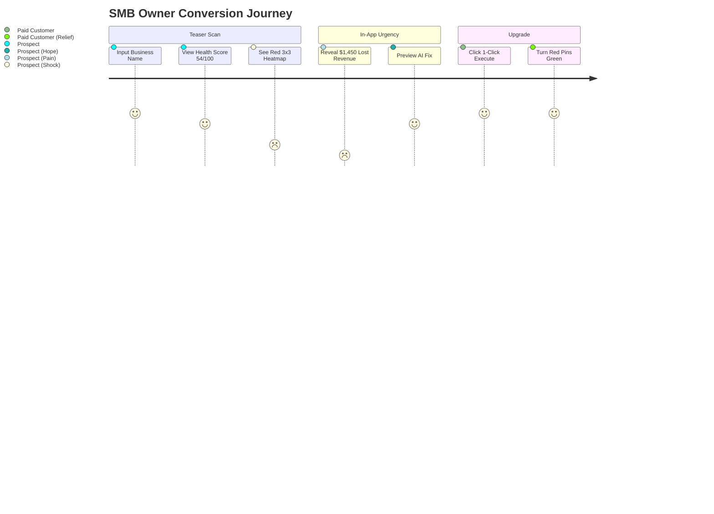

# 06. Monetization & Pricing Policy

## Executive Summary

GBPilot is an autonomous Google Business Profile (GBP) optimization and local Generative Engine Optimization (GEO) SaaS. The monetization strategy is engineered around a dual-engine growth model:
1. **Bottom-Up Product-Led Growth (PLG):** Direct-to-SMB acquisition driven by an instant, zero-friction "Scan & Shock" audit teaser, converting solo business owners into monthly recurring subscriptions.
2. **Top-Down B2B Agency Expansion:** Equipping digital marketing agencies and local SEO consultants with white-label lead-generation audits, automated execution copilot tools, and multi-location management, commanding high LTV accounts ($199–$1,000+/mo).

The pricing model achieves an estimated **>93% Gross Margin** by leveraging ultra-efficient LLM inference (Google Gemini 3.8 Flash) and lightweight asynchronous scraping pipelines.

---

## 1. Subscription Tiers & Packaging Architecture

```
┌────────────────────────────────────────────────────────────────────────────────────────┐
│                                   SUBSCRIPTION TIERS                                   │
├────────────────────┬────────────────────┬────────────────────────┬─────────────────────┤
│     FREE SCOUT     │   STARTER HERO     │   PRO GEO DOMINANCE    │     AGENCY SCALE    │
│      $0 / mo       │   $29 / mo ($24/y) │    $69 / mo ($55/y)    │  $199 / mo ($159/y) │
├────────────────────┼────────────────────┼────────────────────────┼─────────────────────┤
│  Diagnostic Hook   │ Single Location    │ 1-3 Locations          │ 10 Locations + WL   │
│  View-only audit   │ Manual 1-Click     │ Full Autopilot         │ Lead-Gen Audit Kit  │
│  "Red Pin" Shock   │ Weekly Health Scan │ 24/7 Profile Guard     │ Reseller Margins    │
└────────────────────┴────────────────────┴────────────────────────┴─────────────────────┘
```

### Tier 0: Free Scout (The Acquisition Engine)
* **Price:** **$0 / month** (No credit card required).
* **Target:** Cold prospects searching their Google business health or receiving a shared audit link.
* **Core Value:** Immediate quantified diagnosis of ranking leaks, missing attributes, and competitive threats.
* **Package Inclusions:**
  * 1 Business Location.
  * 1 Initial Geo-Grid Scan (3x3 grid, single target keyword).
  * Profile Health Score (0–100) with identified optimization leaks.
  * 1 Sample AI Review Reply & 1 Sample Post Preview (generated, but execution locked).
  * Competitor Benchmark (compares rating and review count with top 3 local pack competitors).
* **Hard Limitations & Paywall Triggers:**
  * ❌ No 1-Click Action Execution (user sees the recommendation but cannot push updates to Google).
  * ❌ No automated recurring scans or rank tracking.
  * ❌ No Profile Guard (zero protection against malicious crowdsourced edits).
  * ❌ Action cards blur after 48 hours unless upgraded.

---

### Tier 1: Starter / "Local Hero"
* **Price:** **$29 / month** (or **$24 / month** billed annually at $288/year — 17% discount).
* **Target:** Single-location independent business owners (cafes, dental clinics, auto repair, salons, solo practitioners).
* **Core Value:** Save 5–10 hours of marketing hassle per month and secure top 3 placement in the immediate neighborhood.
* **Package Inclusions:**
  * **1 Location** included.
  * **Weekly Geo-Grid Tracking:** 3x3 and 5x5 grid scans (up to 3 target keywords).
  * **1-Click Action Engine:** Up to 30 automated actions per month (publishing Google Posts, updating holiday hours, refreshing categories).
  * **AI Review Response Studio:** Up to 30 review responses/month with local LSI entity injection and tone matching.
  * **Basic Profile Guard (Hourly check):** Email/Telegram notifications if Google accepts crowdsourced edits or third-party suggested changes.
  * **Review Velocity Pacing:** Safe review collection scheduling to avoid algorithmic shadowbans.
  * Weekly Email Performance Digest (ranks, views, call clicks).

---

### Tier 2: Pro / "GEO Dominance & Autopilot" (Flagship / 70% Target Mix)
* **Price:** **$69 / month** (or **$55 / month** billed annually at $660/year — 20% discount).
* **Target:** High-ticket local businesses (aesthetic clinics, law firms, real estate, popular restaurants, multi-location clinics).
* **Core Value:** Total hands-off autopilot; guaranteed defensive protection and aggressive expansion into adjacent zip codes.
* **Package Inclusions:**
  * **Up to 3 Locations** included (or 1 flagship location with multi-radius tracking). Extra locations: $19/mo each.
  * **Precision Geo-Grid Tracking:** High-density 7x7 grids, scanned twice weekly or on-demand (up to 10 keywords).
  * **100% Autopilot Mode:**
    * Auto-publish weekly localized Google Posts optimized for seasonal trends.
    * Auto-reply to 4-star and 5-star reviews within 15 minutes, weaving in neighborhood geo-tags and keywords.
    * Auto-draft answers to incoming Google Q&A questions.
  * **Real-Time Profile Guard with 5-Minute Auto-Revert:**
    * Cryptographic baseline state saved.
    * Unauthorized modifications (hours, phone number, category, "permanently closed" flags) are **automatically restored in under 5 minutes** without manual intervention.
  * **Peak Traffic & "Open Now" Engine:** Proactive scheduling recommendations to capture high-converting off-peak search spikes.
  * **Competitor Espionage Matrix:** Daily tracking of top 3 competitors (category alterations, photo velocity, review growth rate).
  * **AI Search (GEO) Audit:** Tracking brand citations in Google AI Overviews, Gemini, and ChatGPT search.
  * Priority Support (Telegram + Email).

---

### Tier 3: Agency & White-Label
* **Price:** **$199 / month** (or **$159 / month** billed annually at $1,908/year — 20% discount).
* **Target:** Digital marketing agencies, local SEO consultants, multi-unit franchise operators.
* **Core Value:** A turnkey business-in-a-box for selling local SEO services with 80%+ margins.
* **Package Inclusions:**
  * **10 Locations included** (+$15/month for each additional location beyond 10).
  * **Full White-Label Branding:**
    * Custom agency domain (`portal.youragency.com`).
    * Custom agency logo, color palette, and favicon.
    * White-label transactional emails and PDF reports.
  * **Client Read-Only Portals:** Create branded client logins with customizable permission controls.
  * **Trojan-Horse Lead-Generation Engine:**
    * Generate unlimited instant audit teaser links with agency branding (`portal.youragency.com/audit/[id]`).
    * One-click export of animated **Rank Replay GIFs** for high-converting cold email outreach.
  * **Bulk Multi-Location Management:** Push holiday hours, emergency closures, or unified promotions across 50+ locations in a single click.
  * **API Access & Webhooks:** Integrate audit data and alerts into internal CRMs (GoHighLevel, HubSpot, Zapier).
  * Dedicated Slack/Telegram Account Manager.

---

## 2. Feature Comparison Matrix

| Feature / Capability | Free Scout | Starter ($29/mo) | Pro Autopilot ($69/mo) | Agency ($199/mo) |
| :--- | :---: | :---: | :---: | :---: |
| **Locations Included** | 1 | 1 | 3 | 10 (+ $15/add-on) |
| **Geo-Grid Density** | 3x3 (1 scan) | 3x3, 5x5 | 3x3, 5x5, 7x7 | All sizes + custom radius |
| **Grid Scan Frequency** | Once on signup | Weekly | 2x / Week + On-demand | Daily / On-demand |
| **Tracked Keywords** | 1 | 3 | 10 | 25 per location |
| **Action Execution** | ❌ Locked | 🟡 1-Click (30/mo) | 🟢 100% Autopilot (Unlimited) | 🟢 Bulk 1-Click & Autopilot |
| **AI Content & Post Generation** | Preview only | 10 posts / mo | Unlimited weekly posts | Unlimited multi-location |
| **AI Review Responses** | 1 test | 30 / mo | Unlimited with Auto-Reply | Unlimited + Multi-brand tone |
| **Profile Guard (Anti-Tamper)**| ❌ None | Hourly alert only | 🟢 **5-Min Auto-Revert** | 🟢 **5-Min Auto-Revert** |
| **Competitor Tracking** | Top 3 static | Top 3 weekly | Top 3 daily deltas | Top 5 per client + alerts |
| **GEO / AI Search Mentions** | ❌ None | ❌ None | 🟢 Google AI & ChatGPT | 🟢 Comprehensive reports |
| **White-Label Client Portal** | ❌ None | ❌ None | ❌ None | 🟢 Custom domain & logo |
| **Lead-Gen Audit Machine** | ❌ None | ❌ None | ❌ None | 🟢 Unlimited public audits |
| **Rank Replay Outreach GIFs** | ❌ None | ❌ None | ❌ None | 🟢 1-Click export |
| **Support** | Community | Email (24h) | Priority Telegram / Chat | Dedicated Slack Manager |

---

## 3. High-Margin Transactional Add-ons & Expansion Streams

To maximize Average Revenue Per User (ARPU) and shorten customer payback periods, GBPilot offers high-margin physical and digital add-ons.

```
┌────────────────────────────────────────────────────────────────────────────────────────┐
│                                 EXPANSION REVENUE STREAMS                               │
├────────────────────────────┬────────────────────────────┬──────────────────────────────┤
│    SMART NFC/QR CARDS      │   CITATION BLAST PACK      │      EXTRA GEO-CREDITS       │
│      $29 – $49 / unit      │      $69 / one-time        │     $19 / 5,000 scans        │
│      Gross Margin: 80%     │     Gross Margin: 85%      │      Gross Margin: 92%       │
└────────────────────────────┴────────────────────────────┴──────────────────────────────┘
```

### 1. Smart Physical NFC / QR Review Stands & Tap Cards
* **Retail Price:** **$29** for 1 Counter Stand, or **$49** for a Bundle (1 Acrylic Stand + 2 Wallet Cards).
* **COGS:** ~$4.50 to $6.00 per unit (manufacturing + encoding + shipping).
* **Gross Margin:** **~80% – 84%**.
* **Value Mechanism:** Physical contactless stand positioned at checkout/reception. When customers tap their iPhone or Android, it instantly launches the Google Maps review box with pre-selected 5 stars. Dynamic shortlinks route through GBPilot to measure cashier performance.

### 2. Local Citation Booster Pack (NAP Syndication)
* **Price:** **$69 one-time** for 25 high-authority local niche citations (Yelp, Apple Maps, Bing Places, Foursquare, YellowPages, local Chamber directories).
* **COGS:** ~$10–$12 via automated aggregator APIs or managed submission partners.
* **Gross Margin:** **~82%**.
* **Value Mechanism:** Solves NAP (Name, Address, Phone) inconsistencies across the web that drag down Google Maps pack rankings.

### 3. Extra Geo-Grid Scan Credit Bundles
* **Price:**
  * **$19** for 5,000 scan points.
  * **$49** for 15,000 scan points.
* **Gross Margin:** **~90%**.
* **Value Mechanism:** For agencies conducting deep audits across large geographic areas or testing dozens of hyper-local keywords.

### 4. Done-For-You GBP Reinstatement & Verification Escort
* **Price:** **$199 one-time**.
* **Value Mechanism:** High-value emergency assistance for businesses facing Google suspensions or re-verification rejections. Handled via step-by-step documentation templates and direct video verification preparation.

---

## 4. Unit Economics & Cost of Goods Sold (COGS)

GBPilot is architected with modern asynchronous microservices and state-of-the-art cost-optimized LLM inference.

### Infrastructure & Inference COGS Breakdown (Per Active Pro Location)

| Cost Component | Monthly Consumption | Provider & Unit Rate | Total Cost / Location |
| :--- | :--- | :--- | :---: |
| **LLM Reasoning & Writing** | 60 prompts / mo (actions, reviews, posts) | Google Gemini 3.8 Flash ($0.15 / 1M tokens) | **$0.024** |
| **Google Places API / Scraping** | 8 grid scans (7x7) + profile polls | Scraper / SerpAPI ($0.001 / SERP) | **$0.400** |
| **Database & Compute** | Supabase Postgres + PostGIS, Railway Worker | Dedicated compute pool | **$0.450** |
| **Transactional Email / SMS** | 15 alerts + weekly digests | Resend / Amazon SES ($0.0001 / msg) | **$0.005** |
| **Total Variable COGS** | — | — | **~$0.88 / location / mo** |

### Gross Margin Calculation

$$\text{Gross Margin (Starter at \$29)} = \frac{\$29 - \$0.65}{\$29} = \mathbf{97.7\%}$$

$$\text{Gross Margin (Pro at \$69)} = \frac{\$69 - \$1.80}{\$69} = \mathbf{97.4\%}$$

$$\text{Gross Margin (Agency 10-loc at \$199)} = \frac{\$199 - \$8.80}{\$199} = \mathbf{95.6\%}$$

*Even with conservative estimates factoring customer support and payment processing fees (Stripe 2.9% + 30¢), blended Gross Margin remains firmly above **92%**.*

---

## 5. Psychological Conversion Triggers & In-App Paywalls



### The 4 Core Conversion Triggers

1. **The "Red Grid Shock" Trigger:**
   * When a business owner runs the free scan and sees red pins across 70% of their city, cognitive dissonance strikes immediately: *"I thought everyone could find me."*
   * The UI displays an estimated lost revenue metric: *"You are missing an estimated 110 customer calls per month due to ranking below position 3."*
   * **Call to Action:** *"Unlock 1-Click Fixes to Turn Red Pins Green"*.

2. **The "Competitor Overtook You" Alert:**
   * Automated monitoring detects when a rival business claims position #2 in the local pack.
   * Email/Telegram: *"⚠️ Urgent: 'Coffee Lab' just outranked you for 'specialty espresso'. Click here to publish the counter-optimization post."*
   * Direct link to paywall with pre-loaded action.

3. **The "Tamper Intercept" Trigger (Profile Guard):**
   * Free users receive a teaser alert: *"Google Maps crowdsource edit detected on your address/hours. Free accounts require manual Google dashboard verification. Upgrade to Pro to auto-revert unauthorized edits in 5 minutes."*

4. **The "Trojan-Horse Agency Funnel":**
   * Agencies send free audit links (`youragency.com/audit/[prospect_id]`) to local businesses.
   * Prospects view the interactive report, complete with the agency's booking calendar and CTA.
   * Agency closes client on a $500–$1,000/mo retainer while paying GBPilot $15/location.

---

## 6. Retention Architecture & Churn Mitigation

To keep Monthly Churn below **3.5%** in a notoriously churn-heavy SMB vertical:

1. **The "Value Delivered" Weekly ROI Digest:**
   * Every Monday morning, users receive a tangible summary:
     * *“This week GBPilot executed 7 optimizations, replied to 9 customer reviews with 18 local keywords, and defended your profile against 1 malicious hours edit. Your Map views increased by +18.4%.”*
   * Reinforces passive value even when the user didn't log into the dashboard.

2. **The $9/Month "Guardian / Sleep Mode" Downsell:**
   * If a user initiates cancellation, do not force an immediate drop to Free.
   * Present the downsell: *"Keep your 24/7 Profile Guard active and preserve your historical rank charts for just $9/month. We will continue protecting your hours and phone number against unauthorized Google edits."*
   * Recovers 25–35% of churning subscribers into high-margin low-maintenance revenue.

3. **Annual Contract Incentive:**
   * Offer 2 months free + 1 free physical NFC counter stand shipped to their door upon annual commitment.

---

## 7. Billing Stack & Technical Implementation

* **Payment Gateway:** Stripe Billing & Customer Portal.
* **Webhook Handling:** Asynchronous FastAPI endpoint `/api/v1/billing/webhook` processing:
  * `customer.subscription.created`
  * `customer.subscription.updated`
  * `customer.subscription.deleted`
  * `invoice.payment_succeeded`
  * `invoice.payment_failed`
* **Schema Synchronization:** Update `organizations.tier` in Supabase (`FREE_TEASER`, `STARTER`, `PRO_AUTOPILOT`, `AGENCY`).
* **Feature Gate Decorators:** Python FastAPI route dependencies `@require_tier(SubscriptionTier.PRO)` enforcing scan limits, action execution permissions, and white-label access.
