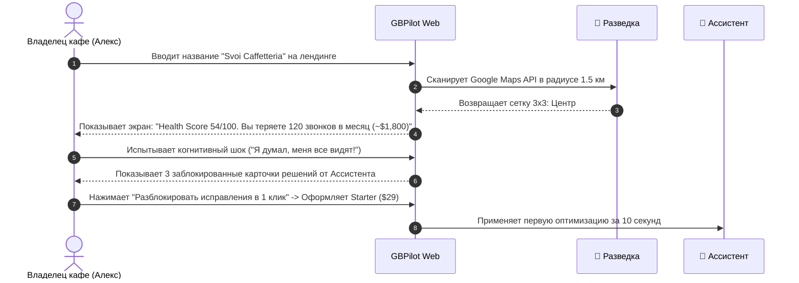
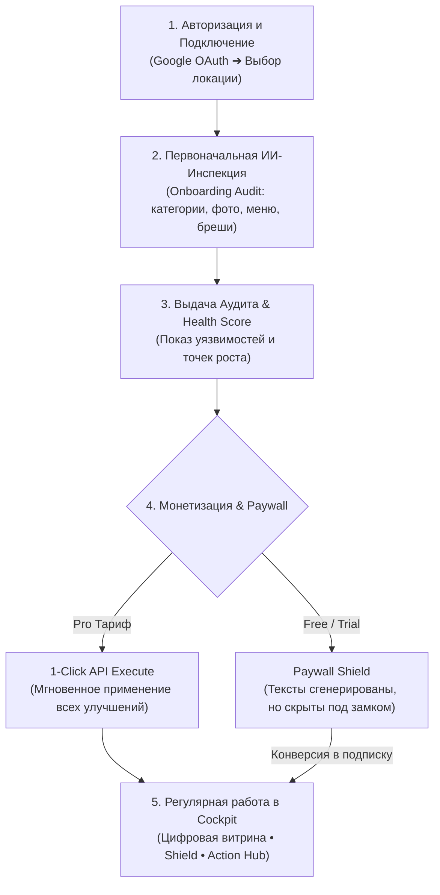

# 08. Фреймворк JTBD и Пользовательские Сценарии

> **Версия Документа:** 1.0.0 (Source of Truth)  
> **Статус:** Активный продуктовый стандарт платформы  
> **Локация:** `Bible_SoT/08_JTBD_AND_CUSTOMER_SCENARIOS.md`  

---

## 1. Фундаментальная Философия JTBD в Local SEO

Владельцы локального бизнеса (рестораны, клиники, салоны красоты, автосервисы) **не покупают SEO-инструменты, графики и тепловые карты**. 

По классической теории Клейтона Кристенсена (Clayton Christensen), они «нанимают» GBPilot на конкретную работу:
> *«Мне плевать на алгоритмы Google. Я нанимаю сервис, чтобы в пятницу вечером в моем заведении не было пустых столов, чтобы конкуренты не увели моих клиентов подлыми правками в картах, и чтобы мне не пришлось платить $1,500 в месяц агентству, которое кормит меня непонятными отчетами».*

### Формула Работы (Job Story):
$$\text{Когда [Контекст / Триггер боли]} \longrightarrow \text{Я хочу [Действие / Механизм]} \longrightarrow \text{Чтобы я мог [Измеримая Выгода / Спокойствие]}$$

---

## 2. Модель 4 Сил Прогресса (Bob Moesta Framework)

Любой локальный предприниматель находится под воздействием четырех противоборствующих сил, определяющих переход на GBPilot:

```
                  ┌──────────────────────────────────────────────┐
                  │              СИЛЫ ПРОГРЕССА (JTBD)           │
                  └──────────────────────────────────────────────┘
           ТОЛКАЮЩИЕ СИЛЫ (ДВИЖЕНИЕ К GBPILOT)   │   ТОРМОЗЯЩИЕ СИЛЫ (СТАТУС-КВО)
                                                │
   1. PUSH (Боль настоящего):                   │   3. ANXIETY (Тревога нового):
   • Стоимость клика в Яндекс/Google Ads        │   • «А вдруг Google забанит мой профиль?»
     выросла на 25% за год.                     │   • «А вдруг ИИ напишет бред или галлюцинацию?»
   • Пустые столы / окна в расписании.          │   • «Не хочу тратить время на сложную настройку».
   • Конкурент открылся рядом и отжимает гостей.│
   • Усталость от рутины и непонятных дашбордов.│
                                                │
   2. PULL (Привлекательность будущего):        │   4. HABIT (Привычка / Инерция):
   • Топ-1 в Google Maps по всему району.       │   • «Попрошу бариста выложить что-то в сторис».
   • 100% автопилот: всё обновляется само.      │   • «Я проверяю карты раз в месяц, вроде норм».
   • Спокойный сон: карточка заведения под      │   • «SEO — это сложно и долго, займусь потом».
     круглосуточной киберзащитой (Гард).        │
```

### Как GBPilot преодолевает сопротивление:
* **Против Anxiety:** Показываем превью до отправки (на Starter), гарантируем FTC/Google комплаенс, используем только безопасные официальные API.
* **Против Habit:** Нулевой TTV — даем шокирующий аудит за 15 секунд без регистрации и привязки карты.

---

## 3. Целевые Персоны и Архетипы Покупателей

### Персона 1: «Соло-Владелец» (Алекс, владелец кофейни / клиники)
* **Профиль:** 32–45 лет. В бизнесе 24/7: решает вопросы поставок, персонала, аренды. Не маркетолог.
* **Бюджет:** $29 – $69 / месяц.
* **Главный страх:** Пустой зал в выходные; негативный отзыв от «хейтера», висящий на первом месте без ответа.
* **Job to be Done:** *«Сделайте так, чтобы меня находили в Google Maps первыми в радиусе 1 км, но чтобы я тратил на это максимум 1 минуту в неделю со смартфона».*
* **Тариф:** **Starter** $\rightarrow$ переход на **Pro** через 2 недели из-за лени.

---

### Персона 2: «Амбициозная Сеть» (Елена, операционный директор 3–5 салонов)
* **Профиль:** Управляет несколькими филиалами в одном городе. Жесткая конкуренция за трафик.
* **Бюджет:** $69 – $150 / месяц.
* **Главный страх:** Конкуренты уводят клиентов, скручивают рейтинг, меняют часы на «Закрыто» в праздники.
* **Job to be Done:** *«Дайте мне полный контроль над территорией города, отражайте любые атаки конкурентов и держите все точки в топе без найма штатного SEO-шника».*
* **Тариф:** **Pro GEO Dominance** (Флагман).

---

### Персона 3: «Владелец Локального Агентства» (Давид, 20+ клиентов на ведении)
* **Профиль:** Продает локальный маркетинг за $500–$1,500/мес с клиента. Уперся в потолок масштабирования ручного труда.
* **Бюджет:** $199 – $500+ / месяц.
* **Главный страх:** Клиенты уходят со словами *«А за что я вам плачу?»*; холодные лиды не конвертируются в созвоны.
* **Job to be Done:** *«Дайте мне безотказный инструмент холодного закрытия клиентов и автоматизируйте рутину ведения профилей под моим брендом с маржой 80%+».*
* **Тариф:** **Agency Scale White-Label**.

---

## 4. Матрица Работ (Job Stories) по Триаде Модулей

```
┌────────────────────────────────────────────────────────────────────────────────────────┐
│                                   JOB STORIES МАТРИЦА                                  │
├─────────────────────┬──────────────────────────────────────────────────────────────────┤
│ 🧭 РАЗВЕДКА (Scout) │ 1. Реалистичная оценка позиций в районе (без розовых очков).     │
│                     │ 2. Обнаружение атак и маневров конкурентов до потери выручки.   │
│                     │ 3. Контроль видимости в ИИ-поисковиках (ChatGPT, Gemini).        │
├─────────────────────┼──────────────────────────────────────────────────────────────────┤
│ 🤖 АССИСТЕНТ        │ 4. Публикация постов и новостей без мук копирайтинга.           │
│    (Copilot)        │ 5. Мгновенные LSI-ответы на отзывы (превращение негатива в плюс).│
│                     │ 6. Перехват вечернего трафика за счет сдвига часов «Open Now».   │
├─────────────────────┼──────────────────────────────────────────────────────────────────┤
│ 🛡️ ГАРД (Shield)    │ 7. Автоматический откат вредоносных правок за 5 минут.          │
│                     │ 8. Безопасный сбор отзывов без риска бана (Review Speedometer).  │
├─────────────────────┼──────────────────────────────────────────────────────────────────┤
│ 💼 АГЕНТСТВО (Scale)│ 9. Холодное закрытие клиентов через Rank Replay GIF и аудиты.    │
└─────────────────────┴──────────────────────────────────────────────────────────────────┘
```

### Job Story 1 (Разведка — Тепловая карта позиций)
> **Когда** я открываю бизнес в районе с высокой конкуренцией,  
> **Я хочу** видеть реальную сетку видимости моего заведения на карте улиц с шагом 200 метров,  
> **Чтобы** точно знать, с каких перекрестков ко мне не доходят люди, и перестать сливать бюджет на слепую рекламу.

### Job Story 2 (Разведка — Шпионаж за конкурентами)
> **Когда** соседнее заведение неожиданно поднимается выше меня в поиске карт,  
> **Я хочу** мгновенно получить отчет о том, что именно они изменили (категорию, фото, ключевики в отзывах),  
> **Чтобы** применить контр-стратегию в 1 клик и вернуть позицию №1.

### Job Story 3 (Ассистент — LSI-ответы на отзывы)
> **Когда** гость оставляет отзыв о визите,  
> **Я хочу**, чтобы ИИ за 15 минут ответил вежливо, персонализированно и нативно вшил микрорайон и ключевые услуги,  
> **Чтобы** поднять репутацию заведения и дать Google мощный SEO-сигнал для ранжирования.

### Job Story 4 (Ассистент — Ловушка «Открыто сейчас»)
> **Когда** в пятницу вечером в районе наступает пик поисковых запросов «где поужинать рядом»,  
> **Я хочу**, чтобы система подсказала скорректировать график работы в Google Maps на 1 час,  
> **Чтобы** мое заведение осталось в топ-3 фильтра «Открыто сейчас», когда все конкуренты выпадут из выдачи.

### Job Story 5 (Гард — Защита от саботажа)
> **Когда** недобросовестный конкурент нажимает «Предложить исправление» и ставит моему кафе статус «Закрыто навсегда» или меняет номер телефона,  
> **Я хочу**, чтобы система без моего участия восстановила правильные данные за 5 минут и прислала отчет,  
> **Чтобы** я не потерял $2,000 выручки за выходные, пока я не смотрю в личный кабинет Google.

### Job Story 6 (Гард — Защита от алгоритмического бана)
> **Когда** я провожу акцию и клиенты начинают массово оставлять отзывы,  
> **Я хочу**, чтобы система дозировала поток ссылок на отзывы (Review Speedometer),  
> **Чтобы** Google не заподозрил накрутку и не отправил карточку заведения в теневой бан.

### Job Story 7 (Агентство — Троянский конь лидогенерации)
> **Когда** я пишу холодное коммерческое предложение потенциальному клиенту,  
> **Я хочу** отправить ему анимированную GIF-сетку с его падающими позициями и ссылку на интерактивный аудит с расчетом потерянных денег,  
> **Чтобы** повысить откликаемость письма с обычных 2% до 20%+ и закрыть чек на $800/месяц.

---

## 5. Детальные Пользовательские Сценарии (Micro-Moments)

### Сценарий A: «Шок от красной сетки» (Cold Conversion)



---

### Сценарий B: «Пятничный ночной саботаж» (The 5-Minute Save)

* **Контекст:** Пятница, 19:40. Пик бронирований столов на вечер.
* **Триггер:** Конкурент из соседнего бара через левый Google-аккаунт отправляет правку: *«Заведение временно закрыто на спецобслуживание»*.
* **Действие системы:**
  1. 19:42 — Модуль **🛡️ Гард** фиксирует несанкционированное изменение атрибута `business_status`.
  2. 19:43 — Сверяет с сохраненным криптографическим эталоном (Canonical Baseline).
  3. 19:45 — Вызывает защищенный Google Business Profile API и восстанавливает статус `OPERATIONAL`.
  4. 19:46 — Отправляет владельцу пуш в Telegram:  
     *«🛡️ Атака отражена! В 19:40 была предпринята попытка закрыть ваше заведение в Google Maps. Гард автоматически восстановил статус за 3 минуты. Ваша карточка активна, бронирования идут»*.
* **Результат:** Владелец понимает, что одна эта ситуация окупила годовую подписку на Pro ($660) десятикратно. Churn rate = 0%.

---

### Сценарий C: «Злой отзыв в 23:00» (LSI Reputation Turnaround)

* **Контекст:** Суббота, 23:15. Гость пишет 2★ отзыв: *«Долго несли стейк, хотя десерты и кофе отличные»*.
* **Действие системы:**
  1. Модуль **🤖 Ассистент** перехватывает отзыв за 3 минуты.
  2. Анализирует тональность: признает задержку кухни, но акцентирует внимание на сильных сторонах.
  3. Генерирует ответ:  
     *«Здравствуйте, Михаил! Приносим извинения за задержку стейка рибай — в субботний вечер на нашей кухне на Арбате был аншлаг. Мы рады, что наш авторский раф и чизкейк вам понравились! Приглашаем вас снова на дегустацию нового мясного меню от шефа...»*
  4. Вшиты LSI-сущности: `стейк рибай`, `на Арбате`, `авторский раф`.
  5. Отправляет пуш владельцу с кнопкой `[Одобрить за 1 клик]` (на тарифе Pro — публикует автоматически).
* **Результат:** Негатив нейтрализован за 15 минут, потенциальные клиенты видят заботу, а Google получает индексацию ключевых слов в профиле.

---

### Сценарий D: «Троянский конь агентства» (B2B Lead Machine)

* **Контекст:** Агентство ищет клиентов в нише стоматологий в Дубае.
* **Действие:**
  1. Агентство вбивает список из 50 клиник в модуль `/outreach`.
  2. GBPilot генерирует 50 персональных анимированных GIF (показывающих, как сетка клиники краснеет за последний месяц).
  3. Менеджер отправляет письмо:  
     *«Доктор Али, пациенты в Dubai Marina не видят вашу клинику на картах при поиске имплантации (вы на 11 месте). Вот 15-секундный GIF вашего падения: [GIF]. Полный бесплатный аудит ваших потерь здесь: [portal.agency.com/audit/9482]»*.
  4. Доктор переходит по ссылке, видит White-Label страницу с логотипом агентства и нажимает кнопку `[Записаться на разбор с агентством]`.
* **Результат:** Конверсия в звонок 19% (вместо 2% у обычного холодного спама).

---

### Сценарий E: «Ликвидация фейкового 1★ отзыва конкурента» (The Anti-Hate Save)

* **Контекст:** Владелец авторской кофейни утром обнаруживает свежий 1★ отзыв без текста или с клеветой: *«Ужасный сервис, нахамили, кофе прокисший, не ходите сюда!»*. Рейтинг падает с 4.8★ до 4.5★. Обычная жалоба через флажок отклонена ботом Google через 24 часа.
* **Действие системы:**
  1. Владелец в модуле **🛡️ Гард** нажимает `[Ликвидировать токсичный отзыв]`.
  2. Gemini 3.8 Flash за 4 секунды анализирует профиль автора отзыва (аккаунт-однодневка, нет истории, совпадение времени с конкурентом) и формулирует **Официальное Юридическое Досье (Google Dispute Dossier)**.
  3. В досье четко зафиксированы нарушения: *Section 3.2: Deceptive Content (Fake Engagement)* и *Section 4.1: Conflict of Interest*. Досье содержит ссылки на конкретные пункты соглашения Google Maps User Contributed Content Policy и готовый текст эскалации для службы модерации 2-го уровня.
  4. Владелец нажимает `[Скопировать апелляцию и открыть форму эскалации Google]`.
* **Результат:** Через 48 часов живой модератор Google подтверждает нарушение и удаляет отзыв. Рейтинг восстанавливается до 4.8★. Владелец в восторге и становится пожизненным амбассадором сервиса на тарифе Pro.

---

## 6. Матрица Трассировки Функций к Работам (Feature-to-Job Traceability)

| Модуль Триады | Функция продукта | Функциональная Работа (Functional Job) | Эмоциональная Работа (Emotional Job) |
| :--- | :--- | :--- | :--- |
| 🧭 **Разведка** | Geo-Grid Heatmap 3x3–7x7 | Измерить видимость на карте с точностью до 100 метров | Снять «розовые очки» и увидеть реальную картину |
| 🧭 **Разведка** | Competitor Radar | Отслеживать каждое действие топ-3 соперников | Чувствовать превосходство и контроль над районом |
| 🧭 **Разведка** | GEO / LLM Share-of-Voice | Проверять цитирование в ChatGPT и Gemini | Быть на шаг впереди трендов современного ИИ |
| 🤖 **Ассистент** | 1-Click Action Feed | Выдавать готовые решения проблем за 1 клик | Избавиться от вины «у меня не доходят руки до маркетинга» |
| 🤖 **Ассистент** | LSI Review Responder | Отвечать на отзывы с локальными гео-тегами | Превратить отзывы в бесплатный SEO-бустер |
| 🤖 **Ассистент** | Dynamic Hours Optimizer | Сдвигать график работы под поисковые пики | Перехватить клиентов, когда конкуренты закрылись |
| 🛡️ **Гард** | 5-Min Diff Auto-Revert | Откатывать чужие правки Google Maps | Спать спокойно, не боясь диверсий конкурентов |
| 🛡️ **Гард** | **Review Takedown™ (Снос отзывов)** | **Юридически сносить несправедливые 1★ отзывы** | **Справедливость и триумф над хейтерами и клеветой** |
| 🛡️ **Гард** | Review Speedometer | Регулировать скорость сбора отзывов | Не бояться теневого бана и штрафов регуляторов |
| 💼 **Агентство** | Rank Replay GIF Engine | Генерировать вирусные анимации для питча | Закрывать клиентов легко и выглядеть топовыми профи |
| 💳 **Add-on** | Физические NFC/QR стойки | Собирать реальные отзывы на кассе в 1 касание | Вовлечь персонал и радовать гостей инновациями |

---

## 7. Расширенная Матрица JTBD (Jobs-To-Be-Done) и User Journey — GB Pilot

Данный раздел представляет собой глубокую детализацию задач (JTBD), сценариев использования (User Journey) и потребностей ключевых клиентских аватаров SaaS-платформы GB Pilot. Служит фундаментом для проектирования интерфейсов, логики онбординга, продуктовых триггеров и алгоритмов автоматизации.

### 7.1. Аватар 1: Владелец одиночного локального бизнеса
*(Примеры: кофейня в курортной зоне, салон красоты, частная стоматология, автосервис)*

* **Контекст и портрет:**  
  Владелец полностью погружен в операционку и обслуживание клиентов. У него нет времени разбираться в SEO-терминах, ключевых словах и алгоритмах Google. Его главный страх — потерять поток клиентов из Google Карт или столкнуться с тем, что конкуренты «поломают» его карточку (изменят часы работы или телефон).

* **Ключевые Триггерные События (Triggers):**
  1. **Негативный опыт:** Конкуренты изменили данные его карточки в Картах, и клиенты поехали по старому адресу или приехали к закрытым дверям.
  2. **Просадка позиций:** Заметил, что при поиске услуг в своем районе его заведение пропало из топ-3 (Local Pack), а конкуренты выросли.
  3. **Рутина с отзывами:** Поток отзывов растет, отвечать вручную некогда, а негатив висит без ответа и портит конверсию.

* **Детальная матрица JTBD:**
  * **Functional Jobs (Функциональные задачи):**
    * **«Убедись, что витрина жива и исправна»:** Когда я открываю приложение с телефона, я хочу за 3 секунды видеть «цифровой двойник» своего заведения (рейтинг, статус Open Now, телефон, часы работы) и понимать, что всё под контролем.
    * **«Автоматическая защита от диверсий»:** Если кто-то попытается внести вредоносную правку в мой профиль (сменить часы, телефон или категорию), система должна перехватить атаку и мгновенно откатить изменения через API без моего участия.
    * **«Интеллектуальные автоответы на отзывы»:** Когда клиент оставляет отзыв, ИИ должен мгновенно отвечать вежливо и с органичным вплетением локальных ключевых слов (LSI), повышая ранжирование в картах.
    * **«Сбор 5-звездочных отзывов без трения»:** Я хочу сгенерировать брендированную табличку с QR-кодом и NFC-чипом для столиков, чтобы гости в 1 тап оставляли отзывы.
  * **Emotional Jobs (Эмоциональные задачи):**
    * **«Избавь от постоянной тревоги за главный канал продаж»:** Чувствовать себя защищенным, зная, что за бизнесом круглосуточно присматривает автономный ИИ-страж (аналог охранной сигнализации).
    * **«Ощущение контроля без погружения в технические детали»:** Видеть понятные бизнес-результаты (сколько выручки защищено, сколько задач решено), а не сложные SEO-графики.
  * **Social Jobs (Социальные задачи):**
    * **«Выглядеть безупречным лидером»:** Поддерживать статус лучшего заведения в районе в глазах клиентов, выбирающих услуги через Google Карты и ChatGPT.

---

### 7.2. Аватар 2: Управляющий сетью или маркетолог локальной компании
*(Примеры: сеть кофеен, фитнес-клубов, медицинских центров из 5–30 филиалов)*

* **Контекст и портрет:**  
  Отвечает за маркетинг и видимость всей сети. Тратит десятки часов на ручное обновление информации по точкам в Google, контроль отзывов и проверку актуальности данных.

* **Ключевые Триггеры:**
  1. **Хаос в данных сети:** При открытии новых точек или смене графиков праздничных дней часть филиалов остается со старыми данными, что ведет к потере клиентов.
  2. **Отсутствие единого дашборда:** Невозможность оценить общую эффективность локального SEO по всей сети без открытия каждого аккаунта по отдельности.

* **Детальная матрица JTBD:**
  * **Functional Jobs (Функциональные задачи):**
    * **«Централизованный мониторинг филиалов»:** Переключаться между точками в 1 клик и видеть сводный индекс здоровья сети.
    * **«Массовое управление и защита»:** Применять защитные протоколы и обновлять контент (акции, праздничные часы) на все локации одновременно или кластерами.
    * **«Районный анализ видимости (Geo-Grid)»:** Видеть тепловые карты ранжирования для каждого филиала, чтобы точечно усиливать маркетинг в отстающих районах.

---

### 7.3. Аватар 3: Локальный SEO-специалист / Маркетинговое агентство
*(Примеры: независимые эксперты по локальному продвижению, digital-агентства)*

* **Контекст и портрет:**  
  Ведет портфель клиентов и нуждается в профессиональных инструментах глубокого анализа, чтобы доказывать свою ценность, проводить быстрые аудиты и продавать услуги сопровождения.

* **Ключевые Триггеры:**
  1. **Поиск клиентов и продажа услуг:** Нужен мощный инструмент экспресс-аудита нового клиента, чтобы наглядно показать ему бреши в профиле и уязвимости перед конкурентами.
  2. **Мониторинг GEO (ИИ-поисковиков):** Необходимость отслеживать, как новые поисковые системы (ChatGPT, Perplexity, Gemini) ранжируют и рекомендуют клиентов в текстовых запросах.

* **Детальная матрица JTBD:**
  * **Functional Jobs (Функциональные задачи):**
    * **«Глубокая инспекция и презентация уязвимостей»:** Проводить мгновенный автоматический аудит профиля с выгрузкой отчета по пропущенным атрибутам, отсутствующим услугам и слабым местам.
    * **«Конкурентная разведка (Overtake Strategies)»:** Анализировать сильные стороны лидеров рынка (Winning Edge) и их уязвимости (Vulnerability), генерируя готовые стратегии обгона.

---

### 7.4. User Journey & Onboarding Flow (Сценарий Взаимодействия)



1. **Авторизация и Подключение:**  
   Вход через Google OAuth ➔ Выбор бизнес-локации из списка доступных профилей.
2. **Первоначальная ИИ-Инспекция (Onboarding Audit):**  
   Система запускает сканирование профиля через API (категории, описание, атрибуты, меню, фото, конкуренты).  
   Выдача результатов в виде структурированного аудита с индексом здоровья (Health Score) и списком найденных брешей.
3. **Монетизация (Paywall Mechanics):**  
   * **Для Pro-тарифа:** Кнопки `[Применить все улучшения в 1 клик через API]` активны, система сразу устраняет все найденные бреши.
   * **Для Free/Trial:** Тексты рекомендаций и оптимизаций сгенерированы, но скрыты под пейволлом (без возможности копирования), наглядно демонстрируя упущенную выгоду и подталкивая к оформлению подписки.
4. **Регулярная работа в Cockpit:**  
   Пользователь заходит на главный экран, видит «цифровую витрину» карточки, статус защиты Shield, ленту задач (Action Hub) и ключевые метрики.

---

### 7.5. Границы Скоупа MVP v1.0 (MVP Scope & Prioritization Standard)

На основе продуктовой калибровки зафиксированы следующие правила реализации для версии **MVP v1.0**:

| Модуль / Сценарий | Статус в MVP v1.0 | Обоснование и Решение |
| :--- | :--- | :--- |
| **Аватар 1 (Соло-владелец)** | 🟢 **100% ФОКУС MVP** | Ядро продукта: Cockpit (цифровой двойник), 1-click Action Feed, автоответы с LSI-ключами, Sentinel Guard от диверсий, Geo-Grid 3x3–5x5. |
| **Аватар 2 (Сети 5–30 точек)** | 🟡 **ТОЛЬКО КВОТА** | Мульти-локационный дашборд и массовые действия (Bulk actions) **исключены из MVP**. Внедряется **строго квотирование лимита локаций**: отображение `X / Y локаций` в дропдауне и блокирующий пейволл при попытке добавить точку сверх лимита тарифа. |
| **Аватар 3 (Агентства)** | ⚪ **ВНЕ СКОУПА MVP** | Холодный outreach, White-Label PDF-генераторы и кастомные агентские отчеты **заморожены** до Post-MVP (v2.0). |
| **QR / NFC Сценарии** | ⚪ **ВЫНЕСЕНО ИЗ MVP** | Генераторы стоек, печать полиграфии и QR-сценарии игнорируются в коде GB Pilot: запланирована интеграция с отдельным готовым проектом **Revo**. |
| **Онбординг (Onboarding)** | 🔒 **ЗАФИКСИРОВАН** | Текущая архитектура входа и инспекции профиля сохраняется **без изменений**. |
